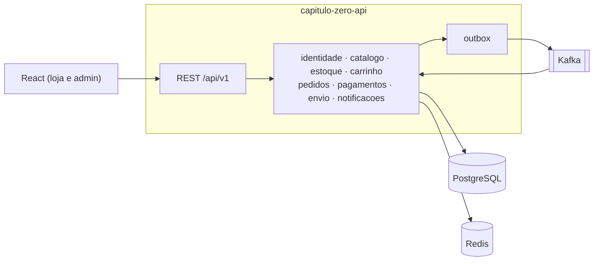

# Capítulo Zero API

Backend de uma livraria online, construído como **monólito modular** com Java 21, Spring Boot 4.1 e
Spring Modulith. Tem catálogo com busca, carrinho, cupons, checkout com reserva de estoque, pagamento Pix
simulado via webhook assinado, envio com rastreio, e-mails transacionais via Kafka e observabilidade com
OpenTelemetry.

Tudo roda localmente com `docker compose`, sem nenhuma conta ou chave de serviço externo.

> Projeto desenvolvido com *spec-driven development*: cada funcionalidade nasceu de uma especificação em
> [`openspec/`](openspec/) antes do código. As specs consolidadas ficam em `openspec/specs/`.

## Arquitetura



Detalhes, fluxo do checkout e máquina de estados do pedido em [`docs/arquitetura.md`](../capitulo-zero-api-harness/capitulo-zero-api/docs/arquitetura.md).
Decisões em [`docs/adr/`](docs/adr/). Contrato de eventos em [`docs/eventos.md`](../capitulo-zero-api-harness/capitulo-zero-api/docs/eventos.md).

## Stack

| Camada | Tecnologia |
|---|---|
| Linguagem e framework | Java 21, Spring Boot 4.1, Spring Modulith 2.1, Lombok, MapStruct |
| Dados | PostgreSQL 17 (um schema por módulo, Flyway), Redis |
| Mensageria | Apache Kafka (KRaft), outbox do Spring Modulith |
| Segurança | Spring Security 7, JWT, refresh token com rotação |
| Qualidade | JUnit 5, Testcontainers, ArchUnit, JaCoCo, Spotless, GitHub Actions |
| Observabilidade | OpenTelemetry, Grafana LGTM (métricas, logs e traces) |

## Como rodar

Pré-requisitos: JDK 21 e Docker.

```bash
docker compose up -d
./mvnw spring-boot:run -Dspring-boot.run.profiles=dev,demo
```

| Serviço | URL |
|---|---|
| API | http://localhost:8080 |
| Swagger UI | http://localhost:8080/swagger-ui.html |
| E-mails (Mailpit) | http://localhost:8025 |
| Grafana | http://localhost:3000 |

## Endpoints

<!-- Atualizado a cada change implementada. -->

## Status

Implementação guiada pelo [roadmap](../capitulo-zero-api-harness/capitulo-zero-api/docs/roadmap.md).
