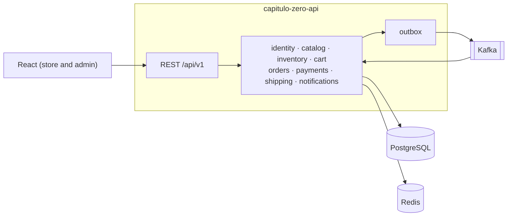

# Capítulo Zero API

Backend of an online bookstore, built as a **modular monolith** with Java 21, Spring Boot 4.1 and
Spring Modulith. It has a catalog with search, cart, coupons, checkout with stock reservation, simulated Pix
payment through a signed webhook, shipping with tracking, transactional e-mails through Kafka and observability
with OpenTelemetry.

Everything runs locally with `docker compose`, without any external service account or key.

> Built with *spec-driven development*: every feature started as a specification in
> [`openspec/`](openspec/) before the code. The merged specs live in `openspec/specs/`.

## Architecture



Details, the checkout flow and the order state machine in [`docs/architecture.md`](docs/architecture.md).
Decisions in [`docs/adr/`](docs/adr/). Event contract in [`docs/events.md`](docs/events.md).
Canonical names in [`docs/glossary.md`](docs/glossary.md).

## Stack

| Layer | Technology |
|---|---|
| Language and framework | Java 21, Spring Boot 4.1, Spring Modulith 2.1, Lombok, MapStruct |
| Data | PostgreSQL 17 (one schema per module, Flyway), Redis |
| Messaging | Apache Kafka (KRaft), Spring Modulith outbox |
| Security | Spring Security 7, JWT, refresh token with rotation |
| Quality | JUnit 5, Testcontainers, ArchUnit, JaCoCo, Spotless, GitHub Actions |
| Observability | OpenTelemetry, Grafana LGTM (metrics, logs and traces) |

## How to run

Requirements: JDK 21 and Docker.

```bash
docker compose up -d
```

The application has a single `application.yaml` and no Spring profiles. Set the variables of
[`.env.example`](.env.example) in your IDE run configuration (at least `CZ_JWT_SECRET`) and run
`CapituloZeroApplication`, or from the shell:

```bash
export CZ_JWT_SECRET=local-development-secret-capitulo-zero-32-bytes-or-more
export CZ_API_DOCS_ENABLED=true
./mvnw spring-boot:run
```

| Service | URL |
|---|---|
| API | http://localhost:8080 |
| Swagger UI (`CZ_API_DOCS_ENABLED=true`) | http://localhost:8080/swagger-ui.html |
| E-mails (Mailpit) | http://localhost:8025 |
| Grafana | http://localhost:3000 |
| Kafka UI (`docker compose --profile tools up -d`) | http://localhost:8090 |

## Endpoints

<!-- Updated with every implemented change. -->

## Status

Implementation guided by the [roadmap](docs/roadmap.md).
