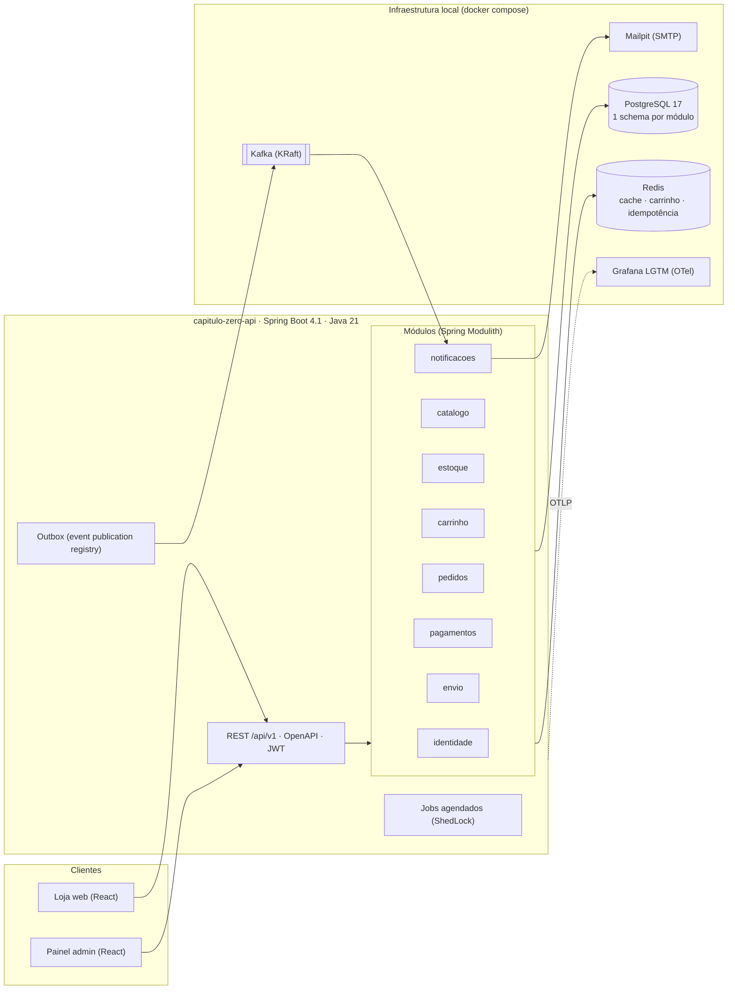
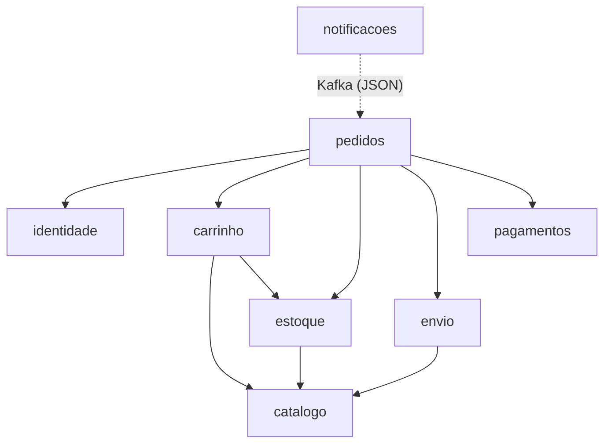
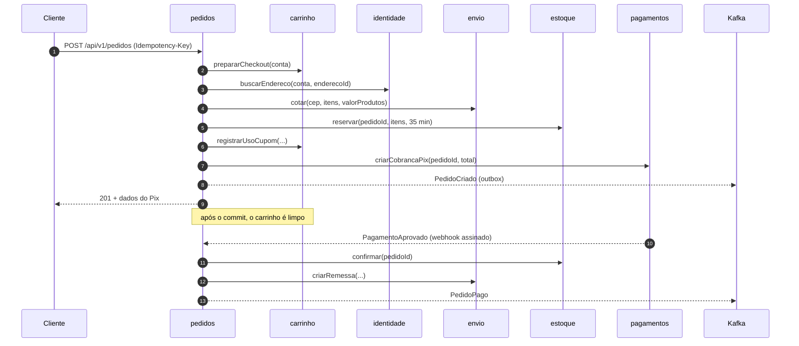
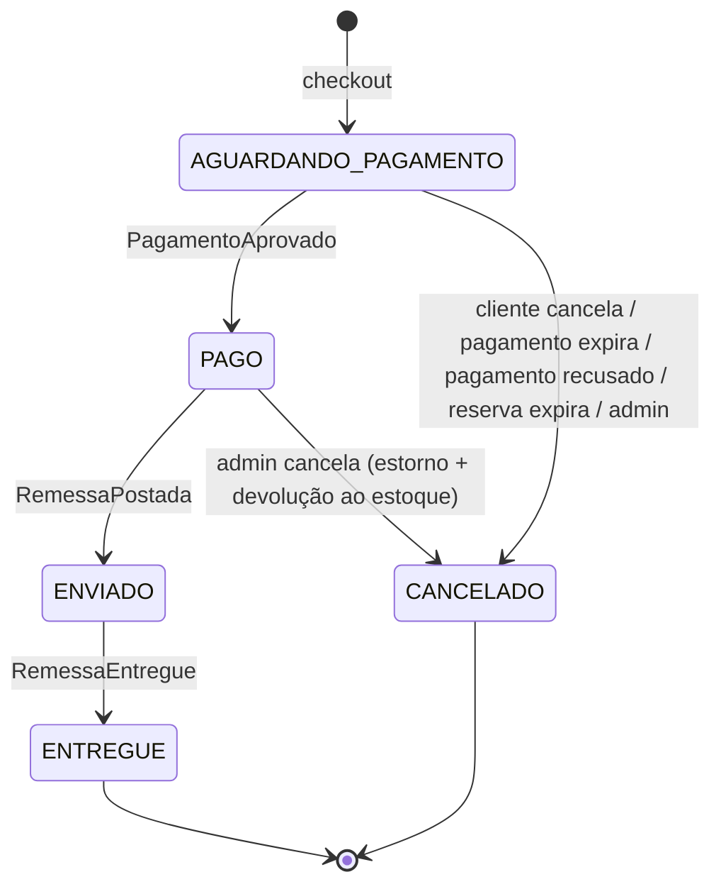

# Arquitetura

O Capítulo Zero é um **monólito modular**: uma única aplicação Spring Boot, implantada como um único artefato,
dividida em módulos de domínio com fronteiras verificadas por teste (Spring Modulith). Os módulos conversam por
uma interface pública (`XxxApi`) quando precisam de resposta imediata e por **eventos de domínio** quando
apenas reagem a um fato. Eventos relevantes para fora do processo são publicados no Kafka a partir de uma outbox.

Não há integrações externas. Pagamento (Pix) e logística são simulados dentro da aplicação, mas pelos mesmos
caminhos de um sistema real: webhook assinado com HMAC, idempotência, expiração e compensação.

## Visão geral

## Módulos e dependências

As setas apontam de quem **depende** para quem **é usado**. A dependência pode ser uma chamada à `XxxApi`
ou o consumo de um evento publicado pelo outro módulo. Todos podem usar `compartilhado`.
A seta tracejada não é uma dependência de código: `notificacoes` só conhece o JSON dos tópicos.

| Módulo | Dados (schema) | Expõe (`XxxApi`) | Publica | Consome |
|---|---|---|---|---|
| identidade | contas, enderecos, refresh_tokens | buscar conta, buscar endereço | `ContaCriada` ⇢ Kafka | n/a |
| catalogo | livros, autores, categorias | resumos de livros | `LivroCadastrado`, `PrecoAlterado`, `LivroDesativado` | n/a |
| estoque | itens_estoque, movimentos, reservas | reservar, confirmar, liberar, devolver, disponibilidade | `ReservaExpirada`, `EstoqueBaixo` ⇢ Kafka | `LivroCadastrado` |
| carrinho | cupons, usos_cupom (+ carrinho no Redis) | preparar checkout, registrar uso de cupom, limpar | n/a | n/a |
| envio | remessas, eventos_remessa | cotar frete, criar e cancelar remessa | `RemessaPostada`, `RemessaEntregue` | n/a |
| pagamentos | cobrancas, webhooks_recebidos | criar e cancelar cobrança, estornar | `PagamentoAprovado`, `PagamentoRecusado`, `PagamentoExpirado`, `PagamentoEstornado` | n/a |
| pedidos | pedidos, itens, historico | n/a | `PedidoCriado`, `PedidoPago`, `PedidoEnviado`, `PedidoEntregue`, `PedidoCancelado` ⇢ Kafka | eventos de pagamentos, estoque e envio |
| notificacoes | notificacoes, mensagens_processadas | n/a | n/a | tópicos Kafka |
| demo (perfil `demo`) | n/a | n/a | n/a | n/a. Popula a loja chamando a própria API REST |

O contrato completo dos eventos e tópicos está em [`eventos.md`](eventos.md).

## Checkout (saga orquestrada pelo módulo pedidos)

Tudo entre os passos 2 e 8 acontece em **uma transação** no mesmo PostgreSQL: se a reserva falhar, nada é gravado.
Redis (limpeza do carrinho) e Kafka (via outbox) ficam fora da transação, por desenho.

## Máquina de estados do pedido

Se um `PagamentoAprovado` chegar para um pedido já `CANCELADO`, o pedido continua cancelado e o pagamento
é estornado automaticamente.

## Decisões

As decisões estão registradas em [`adr/`](adr/):

- [0001](adr/0001-monolito-modular.md): monólito modular com Spring Modulith
- [0002](adr/0002-eventos-outbox-kafka.md): eventos com outbox e externalização para Kafka
- [0003](adr/0003-saga-sem-motor-bpmn.md): saga do checkout sem motor BPMN
- [0004](adr/0004-jwt-proprio.md): autenticação com JWT emitido pela própria aplicação
- [0005](adr/0005-integracoes-simuladas.md): pagamento e envio simulados
- [0006](adr/0006-redis-dados-efemeros.md): Redis apenas para dados efêmeros
