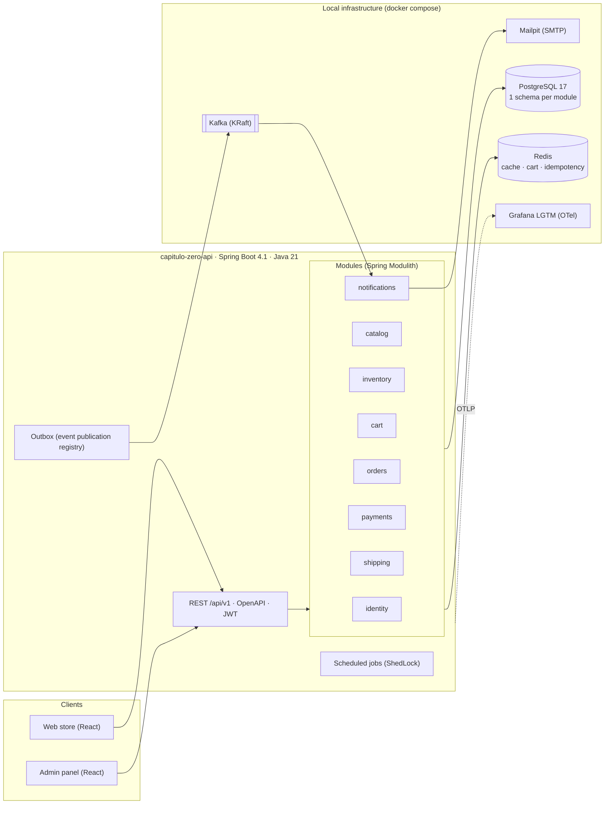
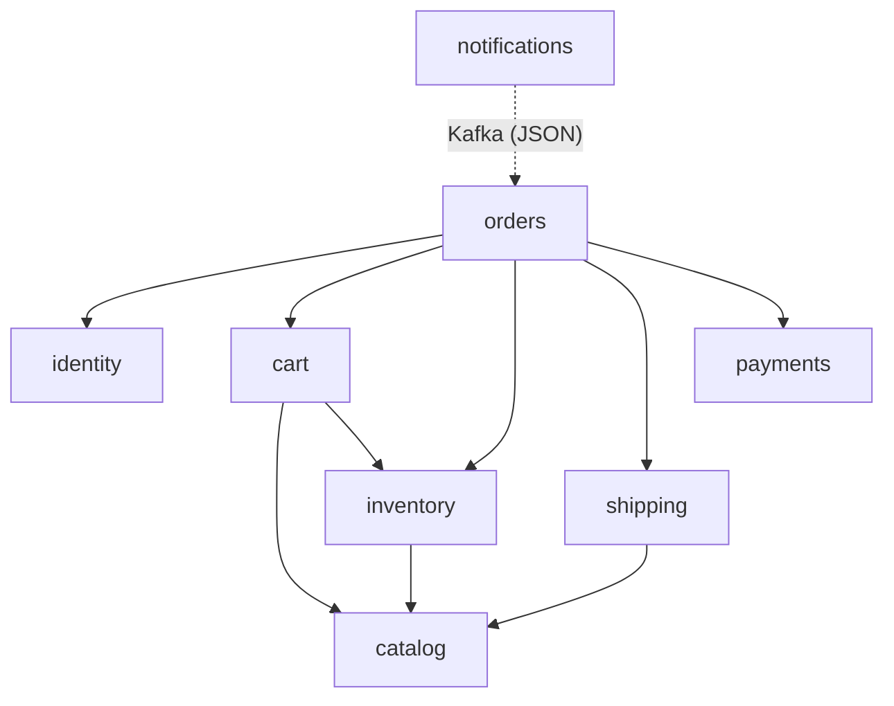
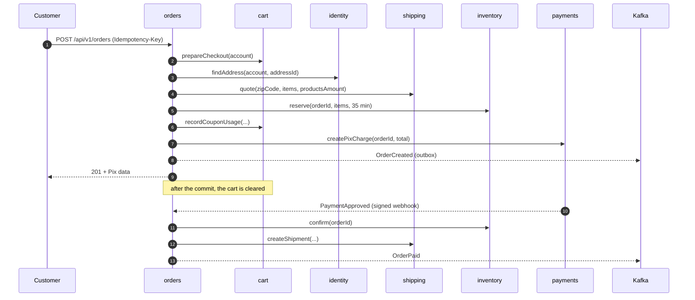
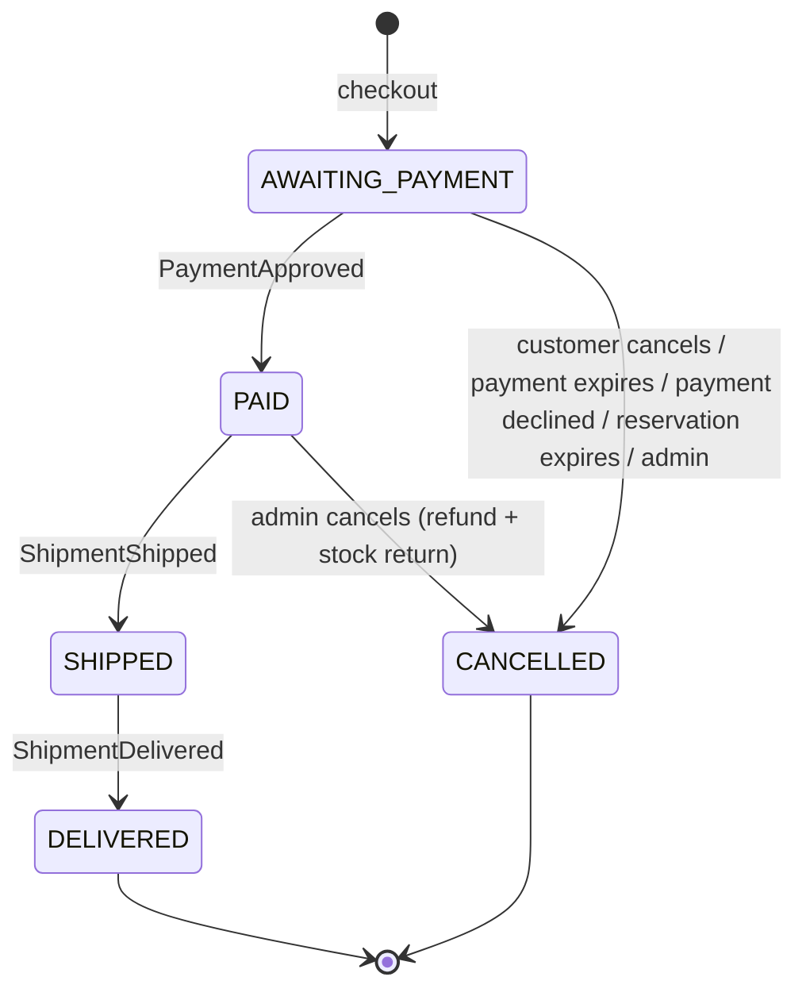

# Architecture

Capítulo Zero is a **modular monolith**: a single Spring Boot application, deployed as a single artifact,
split into domain modules whose boundaries are verified by tests (Spring Modulith). Modules talk through a
public interface (`XxxApi`) when they need an immediate answer and through **domain events** when they only
react to a fact. Events relevant outside the process are published to Kafka from an outbox.

There are no external integrations. Payment (Pix) and logistics are simulated inside the application, but along
the same paths as a real system: HMAC-signed webhook, idempotency, expiration and compensation.

## Overview

## Modules and dependencies

Arrows point from the module that **depends** to the module that **is used**. The dependency can be a call to
the `XxxApi` or the consumption of an event published by the other module. Everyone may use `shared`.
The dashed arrow is not a code dependency: `notifications` only knows the JSON of the topics.

| Module | Data (schema) | Exposes (`XxxApi`) | Publishes | Consumes |
|---|---|---|---|---|
| identity | accounts, addresses, refresh_tokens | find account, find address | `AccountCreated` ⇢ Kafka | n/a |
| catalog | books, authors, categories | book summaries | `BookRegistered`, `PriceChanged`, `BookDeactivated` | n/a |
| inventory | stock_items, stock_movements, reservations | reserve, confirm, release, return, availability | `ReservationExpired`, `LowStock` ⇢ Kafka | `BookRegistered` |
| cart | coupons, coupon_usages (+ cart in Redis) | prepare checkout, record coupon usage, clear | n/a | n/a |
| shipping | shipments, shipment_events | quote shipping, create and cancel shipment | `ShipmentShipped`, `ShipmentDelivered` | n/a |
| payments | charges, received_webhooks | create and cancel charge, refund | `PaymentApproved`, `PaymentDeclined`, `PaymentExpired`, `PaymentRefunded` | n/a |
| orders | orders, order_items, status_history | n/a | `OrderCreated`, `OrderPaid`, `OrderShipped`, `OrderDelivered`, `OrderCancelled` ⇢ Kafka | payments, inventory and shipping events |
| notifications | notifications, processed_messages | n/a | n/a | Kafka topics |
| demo (`cz.demo.enabled=true`) | n/a | n/a | n/a | n/a. Populates the store by calling the application's own REST API |

The full event and topic contract is in [`events.md`](events.md). Canonical names are in
[`glossary.md`](glossary.md).

## Checkout (saga orchestrated by the orders module)

Everything between steps 2 and 8 happens in **one transaction** in the same PostgreSQL: if the reservation fails,
nothing is stored. Redis (cart clearing) and Kafka (through the outbox) stay outside the transaction, by design.

## Order state machine

If a `PaymentApproved` arrives for an order that is already `CANCELLED`, the order stays cancelled and the payment
is refunded automatically.

## Decisions

Decisions are recorded in [`adr/`](adr/):

- [0001](adr/0001-modular-monolith.md): modular monolith with Spring Modulith
- [0002](adr/0002-events-outbox-kafka.md): events with outbox and externalization to Kafka
- [0003](adr/0003-saga-without-bpmn-engine.md): checkout saga without a BPMN engine
- [0004](adr/0004-self-issued-jwt.md): authentication with JWT issued by the application itself
- [0005](adr/0005-simulated-integrations.md): simulated payment and shipping
- [0006](adr/0006-redis-ephemeral-data.md): Redis only for ephemeral data
